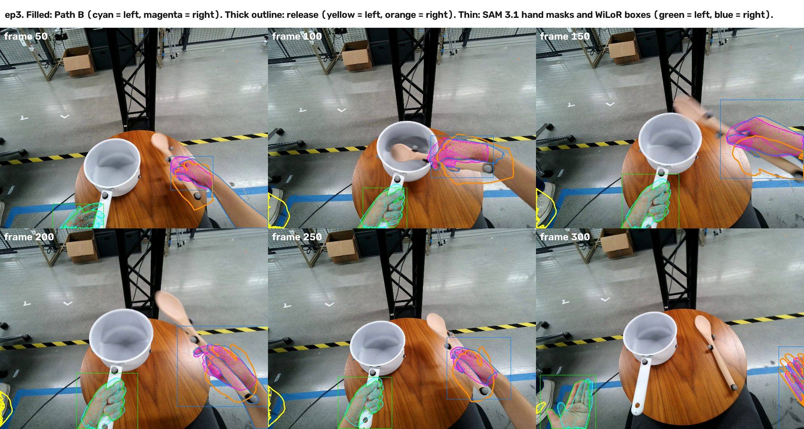

# ep3: the left hand fitted as right, checked in Path B

Handoff "Four hand failures in the released V2D scenes" (baseline refinement team, audit of 1 November 2026), case
**Episode 3**. Checked on 2 November 2026 against the bundle teammates download today, with the doc's own scan-free
acceptance checks (its page 7). Verdict: **the identity failure does not occur in Path B.** Path B's left hand is fitted as
a left hand and sits on the visible left hand on all 313 frames; the release's left hand is off the hand on all 313.

## What the doc reports (release `scored20_alignment_mix_v1_20261030`, HF revision `2b9c4a1`)

- The physical left hand was fitted with right-hand conditioning, then relabelled left after fitting, so the exported
  left mesh lands far from the visible grip.
- Frame 150: the left mesh overlaps 0 of 7,513 observed hand pixels (IoU 0).
- Their isolated left-only rerun: frame 150 IoU 0.766, median depth error 9.97 mm.
- Asked for: keep the anatomical side before HaMeR, never relabel a fitted hand, verify the exported mesh by reprojection.

## What Path B does

| Doc's requirement | Path B |
|---|---|
| Side decided before HaMeR | On every frame P1d gives mask 2 the hand WiLoR calls left and mask 3 the hand it calls right (`fcb731b9`, `pathb/stages/p1d_hands.py` `side_masks`) |
| HaMeR conditioned on that side | Mask 2 is fitted with `is_right` false and mask 3 with true, written to `hand_tracks.json` before HaMeR runs (`p1d_hands.py`, the track loop) |
| No relabel after fitting | The baseline's `run_tracks_interpolate` (the step the doc says relabelled the release) still runs after HaMeR and sets each track's side from HaMeR's own labels. With mask 2 always fitted as left and mask 3 as right it has no tie to break: on ep3 it kept both sides (`handedness.json`: 311 left / 0 right, 0 / 307, no tie-break) |
| Verify the exported mesh | This check (below); not yet an automatic gate in the pipeline |

WiLoR is an independent detector (it does not see HaMeR's conditioning). On ep3 it calls the left track left on 276 of
its 296 matched frames and the right track right on 245 of 256 (`p1d_hands/hand_tracks.json`, `wilor_votes`). The
verification below finds no frame where either Path B hand overlaps the other hand's mask at all.

## Verification

**Data checked** (what teammates use): HF `rose-tea-cafe/v2d-t3-recon`,
`path_b/runs/v4_eval_p4s_bundles/episode_000003/` (last changed in commit `26c11925`; `white_pot` `result.npz` sha256
`2107cfda…`). Both hand sets are re-posed by the baseline loader's own MANO path (`pathb/drivers/mano_world.py`).
Observations, none from HaMeR: Path B's SAM 3.1 hand masks, WiLoR's boxes, the stereo depth. All 313 frames; depth on 32
sampled frames (every 10th and the held-out ones).

| Check (doc p7) | Path B left | Release left | Path B right | Release right |
|---|---|---|---|---|
| Frames with any of the mesh on the other hand's mask | 0 | 0 | 0 | 0 |
| Frames with none of the mesh on its own hand's mask | **0** | **313** | 0 | 0 |
| Share of the mesh on its own hand mask, median (p10) | **0.805** (0.59) | **0.0** (0.0) | 0.628 (0.54) | 0.417 (0.35) |
| Frames with under half the mesh on the mask | 13 | 313 | 27 | 249 |
| Box IoU with WiLoR's box for that hand, median (p10) | **0.72** (0.55) | **0.0** (0.0) | 0.58 (0.41) | 0.55 (0.42) |
| Frames with box IoU under 0.3 | 9 of 285 | 285 of 285 | 6 of 289 | 7 of 289 |
| Depth error vs stereo, median / p90 | **11.7 / 28.6 mm** | none (no overlap) | 8.7 / 30.7 mm | 18.7 / 50.0 mm |
| Depth coverage of the overlap | 72 % | 0 % | 76 % | 74 % |
| Wrist rotation steps over 90° | 0 | 0 | 0 | 0 |
| Export: shipped bundle = Path B's P4 mesh | 0.0 mm on 311 of 313 frames | | 0.0 mm on 307 of 313 | |

Held-out frames, Path B left (release left: 0 on every frame and measure):

| Frame | 0 | 50 | 100 | 150 | 200 | 250 | 300 |
|---|---|---|---|---|---|---|---|
| Share on the left-hand mask | 0.51 | 0.53 | 0.83 | 0.82 | 0.83 | 0.78 | 0.79 |
| Box IoU with WiLoR | (no box) | 0.81 | 0.82 | 0.72 | 0.67 | 0.69 | 0.58 |
| Depth error, median | 5.2 mm | 8.3 mm | 13.5 mm | 11.8 mm | 11.9 mm | 12.3 mm | 9.4 mm |



Filled: Path B (cyan left, magenta right). Thick outline: the release (yellow left, orange right). Thin: SAM 3.1 hand
masks and WiLoR boxes (green left, blue right).

## Limits

- **IoU is not comparable with the doc's 0.766.** Our SAM 3.1 masks include the forearm (68,398 pixels at frame 150, about
  2.4 times the hand mesh), so IoU against them is low (left median 0.31, 0.32 inside WiLoR's box) even where the mesh
  sits on the hand. The share of the mesh on the mask and the box IoU above measure placement instead.
- **Depth:** median 11.8 mm at frame 150 against the doc's rerun 9.97 mm.
- **Weaker frames** are where the hand enters or leaves the view (left: 4, 18–22, 30, 51–55, 266–267), where WiLoR
  also loses it. The largest left wrist step, 73 mm, is at frames 20→21 in that entry stretch.
- **Export:** the bundle and Path B's P4 mesh differ only on the 2 left and 6 right frames whose depth fit P1d rejected
  and interpolated (up to 7.7 and 16.5 mm).
- Joint reprojection (doc p7) is not measured: WiLoR's saved output has no 2-D keypoints.
- The bundle's hands are in Path B's world and camera (factory calibration). Moving them into the release's scene would
  need re-registration: its camera intrinsics and scale differ.

## Reproduce

```bash
# Path B's ep3 hand-stage outputs: path_b/data/outputs/v4_eval/episode_000003 (HF path_b/runs/v4)
$RETARGET_VENV/bin/python path_b/pathb/drivers/mano_world.py <shipped bundle dir> mano_shipped.npz <MANO dir>
$RETARGET_VENV/bin/python path_b/pathb/drivers/mano_world.py <release bundle dir> mano_release.npz <MANO dir>
uv run --project path_b python -I path_b/reports/hand_audit/ep3/ep3_verify.py path_b/data/outputs/v4_eval/episode_000003 \
  <shipped bundle dir> mano_shipped.npz <release bundle dir> mano_release.npz <out dir>
```

`ep3_verify.json` holds the summary and every frame's numbers.
